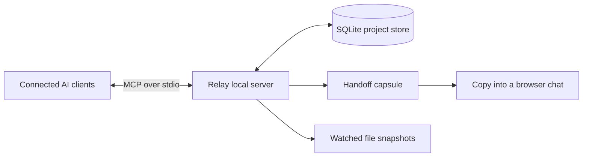

<div align="center">
  
  <h1>Shared context for your AI work</h1>
  <p>Keep useful project decisions and handoff notes in one local place, available to the AI clients you connect.</p>
  <p>
    <a href="LICENSE"></a>
    
    
  </p>
</div>

Relay is a small local service for people who move between AI coding tools. It gives MCP-compatible clients access to the same project memory, builds a copyable handoff capsule, and records changes to watched files so they can be restored.

Relay does **not** read or import private chat histories. Browser-only chats use a handoff capsule that you review and paste yourself.

## What you can do

- **Save and recall decisions.** Connected MCP clients use `aios_remember` and `aios_recall` against one local SQLite database.
- **Carry work to another session.** The dashboard combines saved memories with recorded file changes into a capsule you can review and copy.
- **Review and restore file changes.** Relay records changes it detects in watched workspace files and can restore the previous content from a snapshot.
- **Keep project instructions yours.** Generated context stays in `.aios_shared_context.md`; Relay does not replace `AGENTS.md`, `CLAUDE.md`, `GEMINI.md`, or Cursor rules.

## Quick start

Requirements: macOS, Python 3, and Rust only if you want to build the Rust workspace.

```bash
git clone https://github.com/lakshyab20/relay-ai.git
cd relay-ai
./install-global.sh
./aios control
```

The installer registers Relay's local MCP server for Claude Desktop, Cursor, and Codex. It preserves existing client settings and leaves any existing `aios-continuity` configuration unchanged. Restart those clients after setup. Other MCP clients can use the included project `.mcp.json` or be configured to launch `mission_control/mcp_server.py` from this checkout.

The dashboard opens at `http://localhost:4050`. Add a checkpoint before switching sessions, review the capsule, then copy it into a browser chat if needed.

## Where data lives

- Shared memories and file snapshots: `unified/data/mission_control.db`
- Generated context for clients configured to read a file: `.aios_shared_context.md`
- MCP transport: local stdio process, configured per client

All connected clients must point to the same checkout to share its database. Chat histories are not collected. Memory is saved when you add a checkpoint or a client calls `aios_remember`.

## Build and check

```bash
python3 -m unittest discover -s tests -v
python3 -m py_compile mission_control/*.py unified/*.py
bash -n install-global.sh
cargo test --workspace --locked
```

## Architecture



## Contributing

Read [CONTRIBUTING.md](CONTRIBUTING.md), follow the [Code of Conduct](CODE_OF_CONDUCT.md), and report vulnerabilities using [SECURITY.md](SECURITY.md).

## License

MIT. See [LICENSE](LICENSE).
